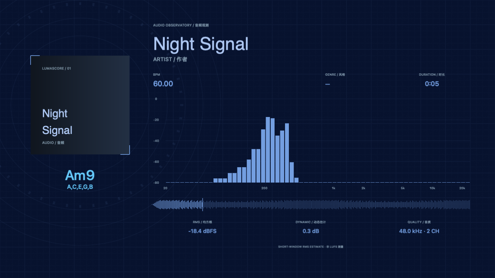

# LumaScore

macOS 上的 MIDI 与音频视觉工作室。用音符、频谱、波形、和弦与 GPU 特效制作可导出的视频。界面保留中文／English。

A native macOS visual studio for MIDI and audio, built with SwiftUI, Metal and AVFoundation. Preview and video export share the same renderer; media stays on your device.

[下载最新版 / Download](https://github.com/Hyperk1ler/LumaScore/releases/latest) · [使用说明](docs/user-guide.zh-CN.md) · [更新记录](docs/history/v2.6.0.md)

## 功能

- MIDI、Audio、Hybrid 三种场景；可只导入音频或只导入 MIDI。
- 真实 PCM 频谱与波形、曲目信息、封面和 RMS 仪表。
- 多轨 MIDI、文件／轨道名称、自动读取速度、和弦分析。
- MIDI 分批追加、删除轨道、逐轨流速／位置／时间偏移与整体重置。
- CRT 干扰、鱼眼、GPU 光晕、粒子、调色、镜头反应、标题动画与本地字体。
- 媒体留白仅延后音频和 MIDI；画面和标题从第 0 秒渲染。
- MP4 硬件编码、WebM 导出、项目保存和视觉预设。
- 独立 `.lumascore` 项目格式，六套原生内置预设与可保存的个人预设。



## 构建 / Build

需要 macOS 和 Xcode。应用主体目标 macOS 13+，构建 arm64/x86_64；内置 WebM 编码组件仅支持 Apple Silicon／macOS 27+。当前运行验证覆盖 Apple M5／macOS 27。下载应用使用 ad-hoc 签名，未 Apple 公证。

```sh
git clone https://github.com/Hyperk1ler/LumaScore.git
cd LumaScore
./native/build.sh
```

构建输出为 `native/build/DerivedData/Build/Products/Release/LumaScore.app`。也可直接打开 `native/LumaScore.xcodeproj`，选择 LumaScore / My Mac。保留完整 `native/Resources/` 目录，其中包含 WebM 运行组件及许可证。

## 测试 / Tests

```sh
./scripts/test-native.sh
./scripts/test-native.sh --playback
bash scripts/test-workspace.sh
```

默认测试覆盖音频分析、音乐理论和弦案例与八度不变性、原生预设、MIDI／快捷键反馈、分批导入与删除持久化、项目格式校验、逐轨布局和时间偏移、三种音频模板、速度图节拍及 Metal 通道。`--playback` 追加静音真实 AVPlayer 播放、延迟交接、暂停、寻址和循环检查。工作区测试检查四种收起状态和测试 App 自己的原生标题栏。需要本机 Metal；测试程序与日志写入被忽略的 `native/build/tests/`。

持续 GUI 呈现帧率尚未实测；测试结果区分播放时钟与离屏渲染验证。

## 目录

| 路径 | 内容 |
| --- | --- |
| `native/` | 当前应用源码、Xcode 工程、生成的测试媒体与运行资源 |
| `docs/` | 使用指南、历史更新和验证摘要 |
| `scripts/` | 测试与发布打包脚本 |
| `outputs/` | 本机最新版交付文件，不进入 Git |
| `Design.pen`、`docs/design/` | 可编辑 UI 与音频场景设计参考 |

完整安装包通过 GitHub Releases 提供，避免将重复构建产物写入 Git 历史。

## License / 许可证

LumaScore 自有源码、文档和原创设计资源采用 [MIT License](LICENSE)，Copyright (c) 2026 Hyperk1ler。允许使用、修改、商用和再发布，须保留版权及许可证声明。

第三方组件不被重新授权为 MIT，仍遵循各自许可证。内置 FFmpeg 编码器使用 GPL-3.0-or-later；其依赖另有 GPL、LGPL、BSD 和 Apache 等协议。组件的版权、许可证和来源记录见 [THIRD_PARTY_NOTICES.md](THIRD_PARTY_NOTICES.md)。
